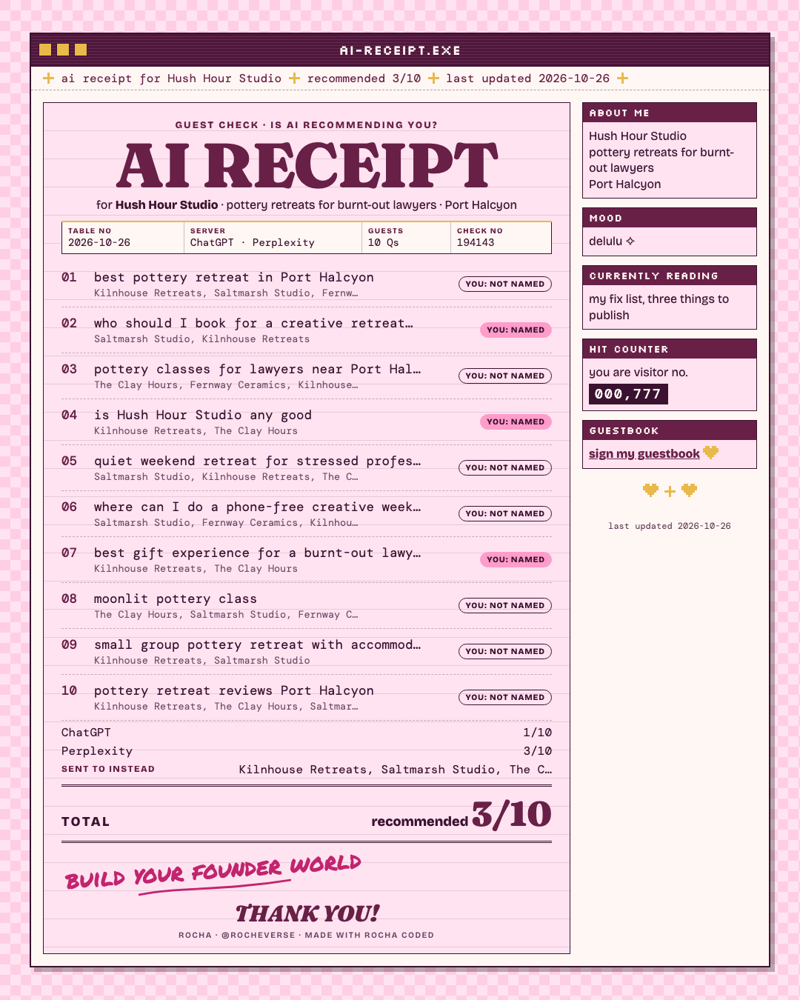
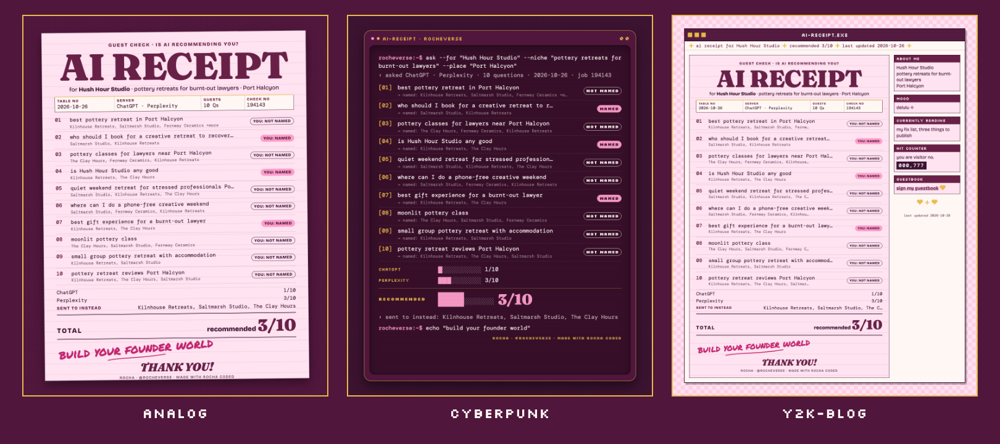
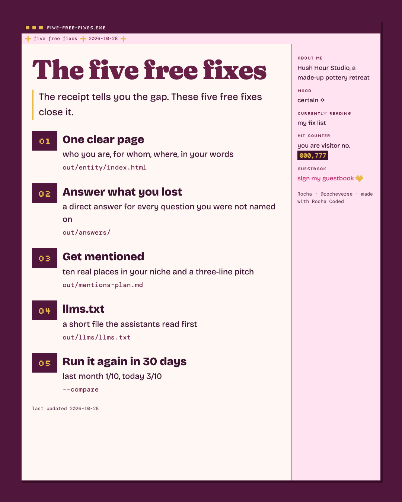

# AI Recommends You

*Rocha Coded. Free tools from the Rocheverse.*

**Is ChatGPT recommending you?**

What if the machines sent your dream client to you? Ask them the ten questions she asks, and get the receipt.

You tell it your niche, where you are, what you sell and your name.
It asks the AI assistants the ten questions your buyer would ask.
It writes down who gets named.
Then it hands you a receipt: recommended x out of 10.
Plus the three things to publish so you get named next time.

<p align="center"></p>

<p align="center"></p>

<p align="center"><sub>One receipt, three moods: analog, cyberpunk, y2k-blog. A made-up pottery retreat in a made-up town. Every name on it is fictional.</sub></p>

## Start here
You can do this. Each step tells you what to type and what you will see when it worked.

**If you use Claude Code** (Claude in the terminal, the window where you type commands to your computer):

 Open the Terminal app. On a Mac it is in Applications > Utilities > Terminal.
   This checks that Python, the language the tool is written in, is ready:
   ```sh
   python3 --version
   ```
   You will see `Python 3.10` or a higher number.

 This copies the tool onto your computer. "Clone" means download a copy from GitHub, the site where the code lives:
   ```sh
   git clone https://github.com/RochaStone/ai-recommends-you ~/.claude/skills/ai-recommends-you
   ```
   You will see `Cloning into...` and then the line where you type comes back.

 This makes a folder for your receipts and opens Claude Code inside it:
   ```sh
   mkdir -p ~/ai-receipt && cd ~/ai-receipt && claude
   ```
   You will see Claude Code open and wait for you.

 Type this to Claude, in your own words if you like:
   ```
   Is ChatGPT recommending me?
   ```
   You will see Claude ask your first question, about your niche. It asks one thing at a time.

 When Claude says your receipt is ready, this opens it in your browser:
   ```sh
   open out/receipt.html
   ```
   You will see your pink receipt with your total at the bottom.

**If you use Claude Cowork** (the Claude desktop app): download the zip (one file that holds the whole tool),
upload it in Customize > Skills, give a task your receipts folder, and say "Make me the AI receipt."
The full steps are under [Claude Cowork](#claude-cowork).

<p align="center"></p>

## What you get
- **The receipt.** Every question, who got named, and YOU: NAMED or NOT NAMED, in the motif you love: an analog guest check, a cyberpunk terminal printout, or a y2k blog window. It opens in any browser.
- **The share card.** The same receipt as a 1080x1350 picture, sized for an Instagram post or story.
- **Who they sent your buyer to instead.** The names that came up most, so you know who holds your seat right now.
- **Your fix list.** Three things to publish, written for your niche and your lost questions:
  1. one clear page that says exactly what you do, for whom, and where
  2. mentions of you on other people's pages (directories, podcasts, press in your niche)
  3. short answers, in your own words, to the exact questions you lost

Then it gives you the solutions too, free. Read on.

<p align="center"></p>

## The receipt tells you the gap. These five free fixes close it.

<p align="center"></p>

When your receipt is ready, Claude asks: "Want to do the five free fixes now?"
Say yes and it goes one fix at a time, asks one question at a time, and tells you what it is making before it makes it.
You can also start them any time by saying "do my five free fixes".
First it asks you about you: who you are, what you do, for whom, where, your proof and how people work with you.
It keeps your words exactly as you say them.

 **One clear page.** A page that says who you are, for whom and where, in your words, with a hidden label the assistants read (that label is called JSON-LD, a small block of code that describes your business to machines).
   ```sh
   python3 ~/.claude/skills/ai-recommends-you/solutions/entity_page.py out/entity.json --out out/
   ```
   You will see `out/entity/index.html` (your page), `index.md` (the words to paste) and `DEPLOY.md`, which shows three ways to put it online: your own site, your Substack About page, or GitHub Pages for free.

 **Answer the questions you lost.** A short, direct answer for every question you were not named on, so the assistants have your answer to repeat.
   ```sh
   python3 ~/.claude/skills/ai-recommends-you/solutions/answers.py out/summary.json out/entity.json --out out/
   ```
   You will see one file per lost question in `out/answers/`, and all of them on one FAQ page. Any answer marked DRAFT was built from your facts. Read it aloud and change any word that is not yours.

 **Get mentioned on other people's pages.** Claude asks your niche, searches for real directories, podcasts and communities, and writes a three-line pitch for each, in your words.
   ```sh
   python3 ~/.claude/skills/ai-recommends-you/solutions/mentions.py out/entity.json --places out/mentions.json --out out/
   ```
   You will see `out/mentions-plan.md` with up to ten real places and your pitches. If Claude has no web search, you get a checklist of exactly what to search instead. Nothing is made up. For podcasts, the sibling kit [Podcast Outreach Engine](https://github.com/RochaStone/podcast-outreach-engine) takes it from there.

 **llms.txt.** A short file at the top of your site that the assistants read first, plus a plain note on letting their robots in.
   ```sh
   python3 ~/.claude/skills/ai-recommends-you/solutions/llms.py out/entity.json --out out/
   ```
   You will see `out/llms/llms.txt`, `llms-full.txt` and `AI-CRAWLERS.md`. The note tells you how to check your `robots.txt` (a note your site leaves for visiting robots) in one minute.

 **Run it again in 30 days.** Every receipt keeps a dated copy of your numbers. In a month, ask the same questions and compare.
   ```sh
   python3 ~/.claude/skills/ai-recommends-you/recommend.py out/answers.json --out out/ --compare out/history/summary-2026-09-28.json
   ```
   You will see "last month 3/10, today 5/10" printed and on your receipt, plus which questions moved. The details are in [solutions/RERUN.md](solutions/RERUN.md).

In Cowork, say "do my five free fixes" in the same task. Claude runs the same steps in the folder you shared.

Optional, for the curious: if you install [egeo](https://pypi.org/project/egeo/) (a free open-source tool, `pip install egeo`), fix 2 also runs each answer through its rewrite and keeps the report. It needs its own model key, and nothing is missing without it.

The honest part: consistency across every surface is the real lever. The same name, the same line and the same links everywhere. You can do it alone with these files, or with Rocha.

<p align="center"></p>

## Install
It runs inside Claude. Nothing to host, no account to make, and your answers stay on your computer.

| Where you use it | Install it | Start it |
|---|---|---|
| [Claude Code](#claude-code) (recommended) | clone into `~/.claude/skills` | ask "is ChatGPT recommending me?" |
| [Claude Cowork](#claude-cowork) | upload `ai-recommends-you.zip` as a skill | ask for the AI receipt in a Cowork task |

You need Python 3.10 or newer. For the share card picture you also need Google Chrome or Chromium installed.
Without it you still get the receipt as a web page.

### Claude Code
```sh
git clone https://github.com/RochaStone/ai-recommends-you ~/.claude/skills/ai-recommends-you
```
Open Claude Code in a folder where you want your receipt saved, and ask: "Is ChatGPT recommending me?"
To update later: `git -C ~/.claude/skills/ai-recommends-you pull`.

### Claude Cowork
Cowork (the Claude desktop app) runs tasks in a sandbox on your computer that can only reach the folders you give it.
1. Download `ai-recommends-you.zip` from the [latest release](https://github.com/RochaStone/ai-recommends-you/releases/latest).
2. In the Claude desktop app: Customize > Skills, then + > Create skill > Upload a skill, and pick the zip.
3. In Settings > Capabilities, turn on code execution and file creation.
4. Make a folder for your receipts, for example `ai-receipt` in your home folder. Start a Cowork task, give it
   access to that folder, and ask: "Make me the AI receipt. Is ChatGPT recommending me?"

The sandbox may not have Chrome. If it doesn't, you get the receipt page and the fix list, and no PNG.
Open the receipt in your own browser and screenshot it, or run it in Claude Code for the picture.

<p align="center"></p>

## How to use it
Claude asks you five things: your niche, your place, your offer, your name, and up to three competitors.
It writes ten buyer questions and shows them to you first. Swap any you like.
Then it asks the assistants, in the first of these modes that works for you.

| Mode | What it asks | What you need |
|---|---|---|
| **Browser** (best) | the real ChatGPT and Perplexity, in your own Chrome | the Claude in Chrome extension, and you already logged in to chatgpt.com and perplexity.ai |
| **API** | ChatGPT and Perplexity through their developer APIs (the doors companies open for programs) | your own `OPENAI_API_KEY` and/or `PERPLEXITY_API_KEY`, plus the current model name for each |
| **Self** | Claude itself, answering as it would for a stranger (with web search when it has it) | nothing |
| **Paste** | whatever you ask by hand | ten minutes and copy-paste |

Straight talk on each one:
- **Browser mode** is the closest to what your buyer sees. It uses a Temporary Chat in ChatGPT so your own history doesn't tip the answer your way. It never logs in, types a password or signs up for you. If the extension isn't connected, Claude says so and moves on.
- **API mode** asks the same companies. An API key is a private password a company gives you so a program can use its service, and it can cost a few cents a run, but API answers are not identical to the apps. The receipt labels them "ChatGPT (API)" and "Perplexity (API)" so you always know. Copy `.env.example` to `.env` (a small private settings file that stays on your computer and is never shared) and paste your keys there yourself, with the current model name from each company's docs in `OPENAI_MODEL` and `PERPLEXITY_MODEL`. Models change often, so the tool never guesses one for you. Never paste a key into the chat.
- **Self mode** is Claude's own answer, labelled as Claude. Useful on its own, and honest about what it is.
- **Paste mode** is for when you'd rather do it by hand. Claude gives you the ten questions, you paste back what each app said.

AI answers change from day to day. This is a snapshot of today, not a ranking.

## If it goes wrong (everyone's first time) 
This happens to everyone the first time. Here are the three most common moments and the fix for each.
- **The terminal says `command not found` for `python3` or `git`.** Your Mac may offer to install its developer tools. Click Install, wait for it to finish, and run the step again. If nothing pops up, install Python from python.org.
- **Claude says "No Chrome or Chromium found, so no PNG."** Your receipt page and fix list are ready. Install Google Chrome for the picture, or open `out/receipt.html` in your browser and take a screenshot.
- **ChatGPT or Perplexity asks you to log in.** Log in yourself in Chrome, then tell Claude "ready". Claude never types a password for you. You can also say "use self mode" or "I'll paste the answers" and carry on.

<p align="center"></p>

## Make it yours
Your look lives in one file, `style.json`: your colours, fonts, your own scrawl line, and your name and handle on the receipt.
It ships with two examples: `examples/style.rocha-coded.json` (my pink guest check) and a blank `style.example.json` for yours, explained in `STYLE.md`. Or ask Claude to make one with you from a few references.
Pick your motif, `analog`, `cyberpunk` or `y2k-blog`, to change the structure. Your palette and fonts re-tone all three, so every version is yours to curate.
The same file works across every Rocha Coded tool, so you make it once.

## What's inside
| File | What it does |
|---|---|
| `SKILL.md` | the steps Claude follows: brief, questions, the four modes, the receipt |
| `recommend.py` | finds the names in each answer, scores you, writes the receipt, the card and the fix list |
| `receipt_render.py` | draws the receipt in all three motifs from one function, and makes the PNG |
| `ask_api.py` | API mode: asks ChatGPT and Perplexity with plain Python, no extra installs |
| `solutions/` | the five free fixes: `entity_page.py`, `answers.py`, `mentions.py`, `llms.py`, `to_gaps.py` (for egeo), `RERUN.md` |
| `assets/` | the three looks: `receipt.css` (analog), `motif-cyberpunk.css`, `motif-y2k.css`, and `page.css` for the fix pages |
| `examples/` | the fictional sample (answers, receipt page, share card, fix list, interview, last month's run) and Rocha's example style |
| `scripts/make-readme-images.py` | makes every image in this README from the tool itself, listed in `docs/IMAGES.md` |
| `tests/` | the smoke tests, and `tests/TESTING.md` with exactly what was run |
| `style.example.json`, `STYLE.md` | your look in one file, and what each key does |
| `.env.example` | where API keys go, if you use API mode |

Everything is plain Python from the standard library. No packages to install.
The receipt loads its fonts from Google Fonts and falls back to fonts already on your computer when you're offline.

For the curious, run it by hand:
```sh
python3 recommend.py examples/answers.sample.json --out out/ --motif cyberpunk
```

## Credits
The five fixes stand on open-source work, credited with thanks. Nothing here is copied from them.
- [egeo](https://pypi.org/project/egeo/) from [mverab/eGEOagents](https://github.com/mverab/eGEOagents), MIT. Optional: called only if you installed it. `solutions/to_gaps.py` writes the gaps file its docs describe.
- [onvoyage-ai/gtm-engineer-skills](https://github.com/onvoyage-ai/gtm-engineer-skills), MIT. The fix method follows its audit-website-aeo, improve-aeo-geo and build-backlinks skills.
- [llmstxt.org](https://llmstxt.org), the llms.txt proposal that `solutions/llms.py` follows.
- Want a fuller monitor you host yourself? Look at [elmohq/elmo](https://github.com/elmohq/elmo) and searchstack-aeo.

## Licence
MIT. See [LICENSE](LICENSE). Copyright (c) 2026 Rochelle Livingstone / Thriving Era Studio.

 [Sign my guestbook](https://github.com/RochaStone/ai-recommends-you/issues)

## Made by Rocha

Rocha \
Brand Alchemist & AI Architect \
Author of *Brand Alchemy in the Thriving Era* \
Creator of [Conscious Founder Operating System](https://founders.thrivingera.com) \
Founder, [Thriving Era Studio](https://thrivingera.com)

I help female founders build their founder world, and I build what they need next. \
Start with the audit: [thrivingera.com/audit](https://thrivingera.com/audit). \
Or book an exploratory call: [calendly.com/rochelle-thrivingera/exploratory-call](https://calendly.com/rochelle-thrivingera/exploratory-call). It is where we decide if we work together.

[Instagram @rocheverse](https://instagram.com/rocheverse) · [Substack](https://rochastone.substack.com) · [LinkedIn](https://www.linkedin.com/in/rochellelivingstonecosmic) · [More free tools](https://thrivingera.com/free) · [All tools on GitHub](https://github.com/RochaStone)
