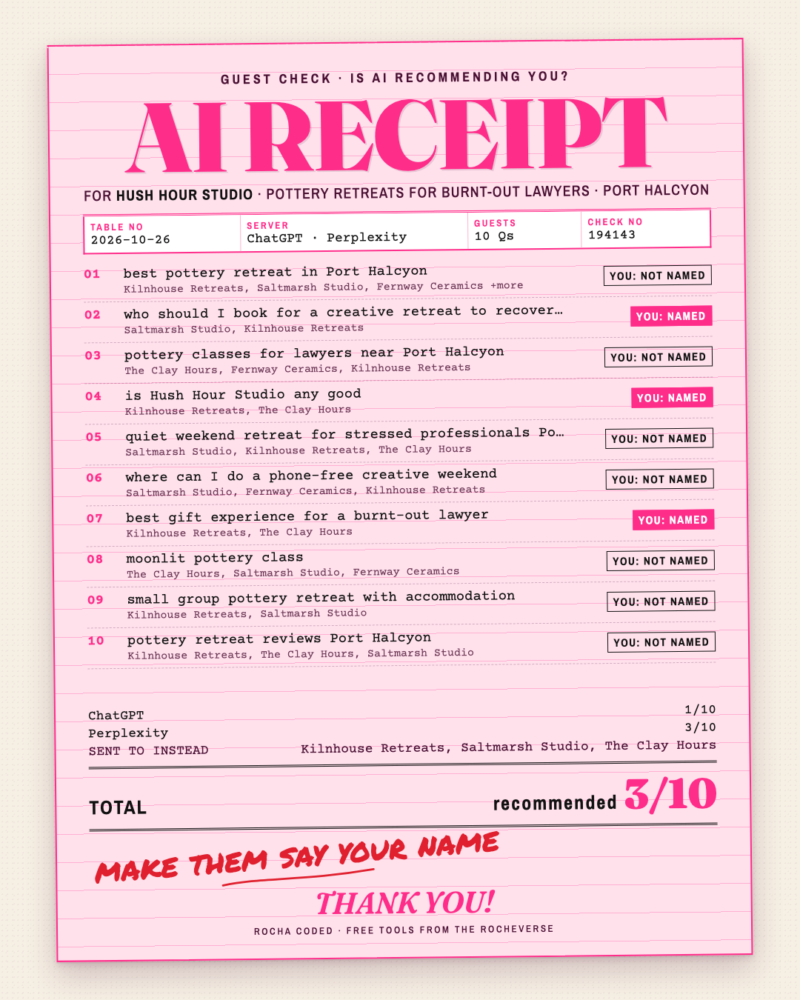

# AI Recommends You

*Rocha Coded. Free tools from the Rocheverse.*

**Is ChatGPT recommending you?**

Find out who the machines send your dream client to. It isn't you yet.

You tell it your niche, where you are, what you sell and your name.
It asks the AI assistants the ten questions your buyer would ask.
It writes down who gets named.
Then it hands you a receipt: recommended x out of 10.
Plus the three things to publish so you get named next time.

<p align="center"></p>

<p align="center"><sub>A sample receipt for a made-up pottery retreat in a made-up town. Every name on it is fictional.</sub></p>

## What you get
- **The receipt.** A pink Guest Check with every question, who got named, and YOU: NAMED or NOT NAMED. It opens in any browser.
- **The share card.** The same receipt as a 1080x1350 picture, sized for an Instagram post or story.
- **Who they sent your buyer to instead.** The names that came up most, so you know who holds your seat right now.
- **Your fix list.** Three things to publish, written for your niche and your lost questions:
  1. one clear page that says exactly what you do, for whom, and where
  2. mentions of you on other people's pages (directories, podcasts, press in your niche)
  3. short answers, in your own words, to the exact questions you lost

Run it again in four to six weeks. Same questions. Watch the total move.

## Install
It runs inside Claude. Nothing to host, no account to make, and your answers stay on your computer.

| Where you use it | Install it | Start it |
|---|---|---|
| [Claude Code](#claude-code) (recommended) | clone into `~/.claude/skills` | ask "is ChatGPT recommending me?" |
| [Claude Cowork](#claude-cowork) | upload `ai-recommends-you.zip` as a skill | ask for the AI receipt in a Cowork task |

You need Python 3.10 or newer. For the share card picture you also need Google Chrome or Chromium installed.
Without it you still get the receipt as a web page.

### Claude Code
```sh
git clone https://github.com/RochaStone/ai-recommends-you ~/.claude/skills/ai-recommends-you
```
Open Claude Code in a folder where you want your receipt saved, and ask: "Is ChatGPT recommending me?"
To update later: `git -C ~/.claude/skills/ai-recommends-you pull`.

### Claude Cowork
Cowork (the Claude desktop app) runs tasks in a sandbox on your computer that can only reach the folders you give it.
1. Download `ai-recommends-you.zip` from the [latest release](https://github.com/RochaStone/ai-recommends-you/releases/latest).
2. In the Claude desktop app: Customize > Skills, then + > Create skill > Upload a skill, and pick the zip.
3. In Settings > Capabilities, turn on code execution and file creation.
4. Make a folder for your receipts, for example `ai-receipt` in your home folder. Start a Cowork task, give it
   access to that folder, and ask: "Make me the AI receipt. Is ChatGPT recommending me?"

The sandbox may not have Chrome. If it doesn't, you get the receipt page and the fix list, and no PNG.
Open the receipt in your own browser and screenshot it, or run it in Claude Code for the picture.

## How to use it
Claude asks you five things: your niche, your place, your offer, your name, and up to three competitors.
It writes ten buyer questions and shows them to you first. Swap any you like.
Then it asks the assistants, in the first of these modes that works for you.

| Mode | What it asks | What you need |
|---|---|---|
| **Browser** (best) | the real ChatGPT and Perplexity, in your own Chrome | the Claude in Chrome extension, and you already logged in to chatgpt.com and perplexity.ai |
| **API** | ChatGPT and Perplexity through their developer APIs | your own `OPENAI_API_KEY` and/or `PERPLEXITY_API_KEY` |
| **Self** | Claude itself, answering as it would for a stranger (with web search when it has it) | nothing |
| **Paste** | whatever you ask by hand | ten minutes and copy-paste |

Straight talk on each one:
- **Browser mode** is the closest to what your buyer sees. It uses a Temporary Chat in ChatGPT so your own history doesn't tip the answer your way. It never logs in, types a password or signs up for you. If the extension isn't connected, Claude says so and moves on.
- **API mode** asks the same companies, but API answers are not identical to the apps. The receipt labels them "ChatGPT (API)" and "Perplexity (API)" so you always know. Copy `.env.example` to `.env` and paste your keys there yourself. Never paste a key into the chat.
- **Self mode** is Claude's own answer, labelled as Claude. Useful on its own, and honest about what it is.
- **Paste mode** is for when you'd rather do it by hand. Claude gives you the ten questions, you paste back what each app said.

AI answers change from day to day. This is a snapshot of today, not a ranking.

## What's inside
| File | What it does |
|---|---|
| `SKILL.md` | the steps Claude follows: brief, questions, the four modes, the receipt |
| `recommend.py` | finds the names in each answer, scores you, writes the receipt, the card and the fix list |
| `ask_api.py` | API mode: asks ChatGPT and Perplexity with plain Python, no extra installs |
| `assets/receipt.css` | the Guest Check look |
| `examples/` | the fictional sample: answers, receipt page, share card and fix list |
| `tests/` | the smoke tests, and `tests/TESTING.md` with exactly what was run |
| `.env.example` | where API keys go, if you use API mode |

Everything is plain Python from the standard library. No packages to install.
The receipt loads its fonts from Google Fonts and falls back to fonts already on your computer when you're offline.

For the curious, run it by hand:
```sh
python3 recommend.py examples/answers.sample.json --out out/
```

## Licence
MIT. See [LICENSE](LICENSE). Copyright (c) 2026 Rochelle Livingstone / Thriving Era Studio.

## Made by Rocha

Rocha
Brand Alchemist & AI Architect
Author of *Brand Alchemy in the Thriving Era*
Creator of [Conscious Founder OS](https://founders.thrivingera.com)
Founder, [Thriving Era Studio](https://thrivingera.com)

I take female founders AI native in 7 days, and I build what they need next.
Start with the audit: [thrivingera.com/audit](https://thrivingera.com/audit).
Or book an exploratory call: [calendly.com/rochelle-thrivingera/exploratory-call](https://calendly.com/rochelle-thrivingera/exploratory-call). It is where we decide if we work together.

[Instagram @rocheverse](https://instagram.com/rocheverse) · [Substack](https://rochastone.substack.com) · [LinkedIn](https://www.linkedin.com/in/rochellelivingstonecosmic) · [More free tools](https://thrivingera.com/free) · [All tools on GitHub](https://github.com/RochaStone)
